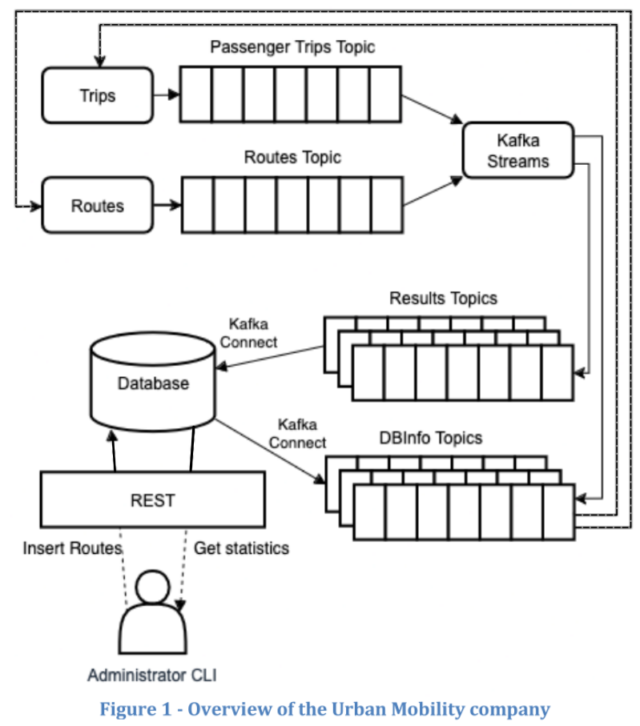

# Urban Mobility Company - Message Oriented Middleware (MOM) and Kafka Streams Project

## Index
- [Project Overview](#project-overview)
- [Project Requirements](#project-requirements)
- [Repository Structure](#repository-structure)
- [Usage Instructions](#usage-instructions)
- [Recommended VSCode Extensions](#recommended-vscode-extensions)

## Project Overview
This project simulates an urban mobility system using Apache Kafka and event-driven communication. It uses Kafka topics to exchange route and passenger trip events, while Kafka Streams processes these events to calculate metrics such as route occupancy, available seats, passenger counts, and transport usage statistics.
The project integrates Kafka with a database using Kafka Connect and explores distributed system resilience through a multi-broker setup, allowing the system to continue operating in the event of a broker failure.

- **Course**: Systems Integration.
- **Technologies**: Kafka, KRaft (Zookeper), Docker, Java, REST, Postgres, Spring Boot, Maven.
- **Libraries**: Lombok, Reactor Core, Log4j.

**Figure 1**  presents the overview of the project.



- **DBInfo Topics** - Source connectors stream Route suppliers and Route passenger capacities from the database.
- **Routes topic** - Each route includes its passenger capacity, the origin and destination, the transport type, e.g., Bus, Taxi, Train, Metro, Scooter, and the Operator name/identifier that provides the route.
- **Trips topic** - Each trip has a Route/name id reference, a destination and origin, a Passenger name/identifier, and a transport type (e.g., Bus, Taxi, Train, Metro, Scooter).
- **Results Topics** - Routes and Trips topics are computed by a Kafka Processor and the results are streamed to this topic. Its records are then written int the database via a sink connector. The metrics computed are enumerated in the metrics requirements below.

- **REST Server** - Exposes the metrics results from the database.

The connection between the DBInfo topics and the Routes and Trips does not exist. Instead there are producers of Routes and Trips that generate records of these. The purpose of DBInfo topics in the assignment was to evaluate the implementation of the Kafka Connect Source Connector.

## Project Requirements
- Add route suppliers to the database.
- List route suppliers from the database.
- Add routes to the database.
- Serializer/Deserializer (CustomSerializer or JSON serialized to a Java object. e.g. KStream<String, Route>).
- Configure Kafka with multiple brokers to enable Fault-Tolerance.
- Source connections to read from the database.
- Sink connections to send results to the database.
- Enabling simple verification of results.

### Metrics Requirements
4. Get the passengers per route (use information from trips topic only).
5. Get the available seats per route (Use information from routes topic only).
6. Get The Occupancy percentage per trip.
7. Get total passengers (from trips topic only).
8. Get total seating available for all routes (from the routes topic only).
9. Get the occupancy percentage total (for all routes),
10. Get the average number of passengers per transport type.
11. Get the transport type with the highest number of served passengers (only one if there is a tie).
12. Get the routes with the least occupancy per transport type.
13. Get the most used transport type in the last hour (use a tumbling time window).
14. Get the least occupied transport type in the last hour (use a tumbling time window).
15. Get the name of the route operator with the most occupancy. Include the value of occupancy.
16. Get the name of the passenger with the most trips.

## Repository Structure
``` text
.
├── .env.example
├── .gitignore
├── Dockerfile
├── README.md
├── docker-compose.yml
├── docs
│   ├── assignment.pdf -> Assignment of this project
│   └── image.png
└── server
    ├── pom.xml
    ├── src
    │   └── main
    │       ├── java
    │       │   └── pt
    │       │       └── is
    │       │           └── assignment3
    │       │               ├── Assignment3App.java
    │       │               ├── controller
    │       │               │   ├── CapacityController.java
    │       │               │   ├── ResultsController.java
    │       │               │   └── SupplierController.java
    │       │               ├── entity
    │       │               │   ├── ResultsReq04.java 
    │       │               │   ├── ResultsReq05.java
    │       │               │   ├── ResultsReq06.java
    │       │               │   ├── ResultsReq07.java
    │       │               │   ├── ResultsReq08.java
    │       │               │   ├── ResultsReq09.java
    │       │               │   ├── ResultsReq10.java
    │       │               │   ├── ResultsReq11.java
    │       │               │   ├── ResultsReq12.java
    │       │               │   ├── ResultsReq13.java
    │       │               │   ├── ResultsReq14.java
    │       │               │   ├── ResultsReq15.java
    │       │               │   ├── ResultsReq16.java
    │       │               │   ├── Route.java
    │       │               │   ├── RouteCapacity.java
    │       │               │   ├── RouteSupplier.java
    │       │               │   └── Trip.java
    │       │               ├── kafka
    │       │               │   ├── processors
    │       │               │   │   └── KafkaStreamsProcessor.java -> Metrics Processor (Requirements [04-16])
    │       │               │   ├── producers
    │       │               │   │   ├── RoutesCenario.java  -> deterministic data Producer
    │       │               │   │   ├── RoutesProducer.java -> random data Producer
    │       │               │   │   ├── TripsCenario.java   -> deterministic data Producer
    │       │               │   │   └── TripsProducer.java  -> random data Producer
    │       │               │   └── utils
    │       │               │       ├── KafkaJSONDeserializer.java
    │       │               │       ├── KafkaJSONSerde.java
    │       │               │       └── KafkaJSONSerializer.java
    │       │               ├── repository
    │       │               │   ├── CapacityRepository.java
    │       │               │   ├── Req04Repository.java
    │       │               │   ├── Req05Repository.java
    │       │               │   ├── Req06Repository.java
    │       │               │   ├── Req07Repository.java
    │       │               │   ├── Req08Repository.java
    │       │               │   ├── Req09Repository.java
    │       │               │   ├── Req10Repository.java
    │       │               │   ├── Req11Repository.java
    │       │               │   ├── Req12Repository.java
    │       │               │   ├── Req13Repository.java
    │       │               │   ├── Req14Repository.java
    │       │               │   ├── Req15Repository.java
    │       │               │   ├── Req16Repository.java
    │       │               │   └── SupplierRepository.java
    │       │               └── service
    │       │                   ├── CapacityService.java
    │       │                   ├── ResultsService.java
    │       │                   └── SupplierService.java
    │       └── resources
    │           ├── application.properties
    │           ├── kafka-connect
    │           │   ├── config
    │           │   │   ├── README.md
    │           │   │   ├── create_connectors.sh -> script to create the source and sink connectors
    │           │   │   ├── get_connectors.sh
    │           │   │   ├── sink.json    -> results topics route_capacity database sink connector
    │           │   │   ├── source1.json -> DBInfo route_capacity topic database source connector
    │           │   │   └── source2.json -> DBInfo route_supplier topic database source connector
    │           │   └── lib
    │           │       ├── kafka-connect-jdbc-10.8.0.jar
    │           │       └── postgresql-42.7.4.jar
    │           └── schema
    │               ├── diagrams
    │               │   ├── conceptual.png
    │               │   └── onda_conceptual_diagram.json
    │               └── migrations
    │                   └── 1-create_tables.sql
```

## Usage Instructions
### Containers Start and Stop

- If it is the first time the containers are going to be run then it will be necessary to build them: ```docker compose up --build``` and ```^C``` to stop them.

- If not the first time:
    - And you want the containers to run in the standard mode: ```docker compose up``` and then ```^C``` to stop them.

    - If you want them to be run in the background: ```docker compose up -d``` and then ```docker compose down``` to stop them.

### Access a Container

- To access the server container: ```docker compose exec server /bin/zsh```.
<!-- - To access the client container: ```docker compose exec client /bin/zsh```. -->

### REST Server
- From the server container workspace run: ```mvn spring-boot:run```.

### Kafka-Connect
- If it is the first time, perform the following commands inside the container workspace: ```cd src/main/resources/kafka-connect/config```, ```chmod +x create_connectors.sh```, ```./create_connectors.sh```.
- To consume the dbinfo topics (the source ones): ```kafka-console-consumer.sh --bootstrap-server broker1:9092 --topic dbinforoute_capacity --from-beginning```, ```kafka-console-consumer.sh --bootstrap-server broker1:9092 --topic dbinforoute_supplier --from-beginning```.

### Run the Code
- If it is the first time or changes were made to the code, it will be necessary to compile: ```mvn compile```.
- To run the intended Java file:\
 ```mvn exec:java -Dexec.mainClass="pt.is.assignment3.kafka.producers.RoutesCenario"```\
 ```mvn exec:java -Dexec.mainClass="pt.is.assignment3.kafka.producers.TripsCenario"```\
 ```mvn exec:java -Dexec.mainClass="pt.is.assignment3.kafka.producers.RoutesProducer"```\
```mvn exec:java -Dexec.mainClass="pt.is.assignment3.kafka.producers.TripsProducer"```\
```mvn exec:java -Dexec.mainClass="pt.is.assignment3.kafka.processors.KafkaStreamsProcessor"```

### Testing
- To check the output of a topic (example)run:```kafka-console-consumer.sh --bootstrap-server broker1:9092 \
--topic results_req10 \
--property print.key=true \
--property print.value=true \
--property key.deserializer=org.apache.kafka.common.serialization.StringDeserializer \
--property value.deserializer=org.apache.kafka.common.serialization.StringDeserializer --from-beginning```
- To descibe a topic run: ```kafka-topics.sh --describe --bootstrap-server broker1:9092 --topic resultstopic``` 
## Recommended VSCode Extensions

- **[Extension Pack for Java](https://marketplace.visualstudio.com/items?itemName=vscjava.vscode-java-pack)**  
   Popular extensions for Java development that provides Java IntelliSense, debugging, testing, Maven/Gradle support, project management and more.

- **[Better Comments](https://marketplace.visualstudio.com/items?itemName=aaron-bond.better-comments)**     
    Improve your code commenting by annotating with alert, informational, TODOs, and more!

- **[Docker](https://marketplace.visualstudio.com/items?itemName=ms-azuretools.vscode-docker)**     
    Makes it easy to create, manage, and debug containerized applications.

- **[Error Lens](https://marketplace.visualstudio.com/items?itemName=usernamehw.errorlens)**        
    Improve highlighting of errors, warnings and other language diagnostics.

- **[GitLens — Git supercharged](https://marketplace.visualstudio.com/items?itemName=eamodio.gitlens)**     
    Supercharge Git within VS Code — Visualize code authorship at a glance via Git blame annotations and CodeLens, seamlessly navigate and explore Git repositories, gain valuable insights via rich visualizations and powerful comparison commands, and so much more

- **[Lombok Annotations Support for VS Code](https://marketplace.visualstudio.com/items?itemName=vscjava.vscode-lombok)**   
    Refactor code with Lombok annotations, or remove Lombok annotations with actual methods.

- **[Red Hat Dependency Analytics](https://marketplace.visualstudio.com/items?itemName=redhat.fabric8-analytics)**  
    Provides insights on security vulnerabilities in your application dependencies.
 